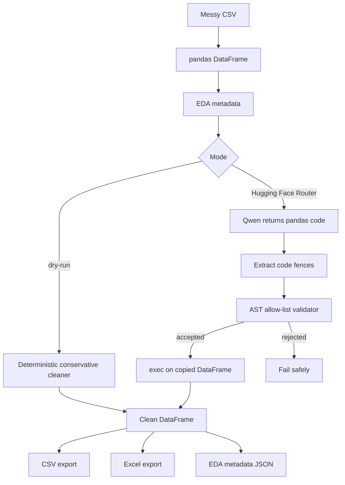

# Day 8 Architecture

## Data flow

1. `pandas.read_csv()` loads the input into memory.
2. `inspect_dataframe()` calculates shape, dtypes, null counts, duplicates, numeric skewness, and a small sample.
3. Hugging Face Router receives metadata and returns code intended to transform a variable named `df`.
4. `extract_code()` removes accidental Markdown fences.
5. `validate_cleaning_code()` parses the AST and applies a strict allow-list.
6. `execute_cleaning_code()` executes only accepted code against a deep copy.
7. The cleaned DataFrame is exported to CSV, Excel, and a JSON report.

## Why AST validation matters

`exec()` can execute arbitrary Python. A language model can make mistakes or return unsafe code, so the project rejects imports, filesystem/network operations, dynamic evaluation, and unsupported constructs before execution. This is defense in depth, not a complete sandbox. Production systems should isolate generated code in a disposable process or container with OS-level controls.

## Hugging Face boundary

The default model is `Qwen/Qwen2.5-Coder-32B-Instruct:featherless-ai`, called through `https://router.huggingface.co/v1/chat/completions`. The request contains EDA metadata and three sample rows, not the full CSV. This reduces data transfer but does not eliminate privacy concerns: sample rows may contain personal or confidential information. Remove or anonymize sensitive fields before using Hugging Face mode.
